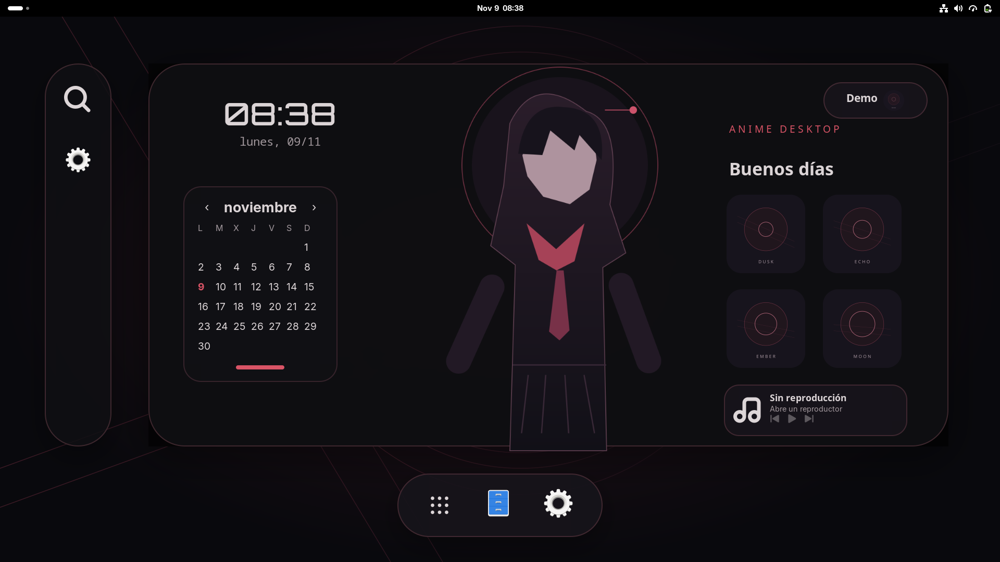
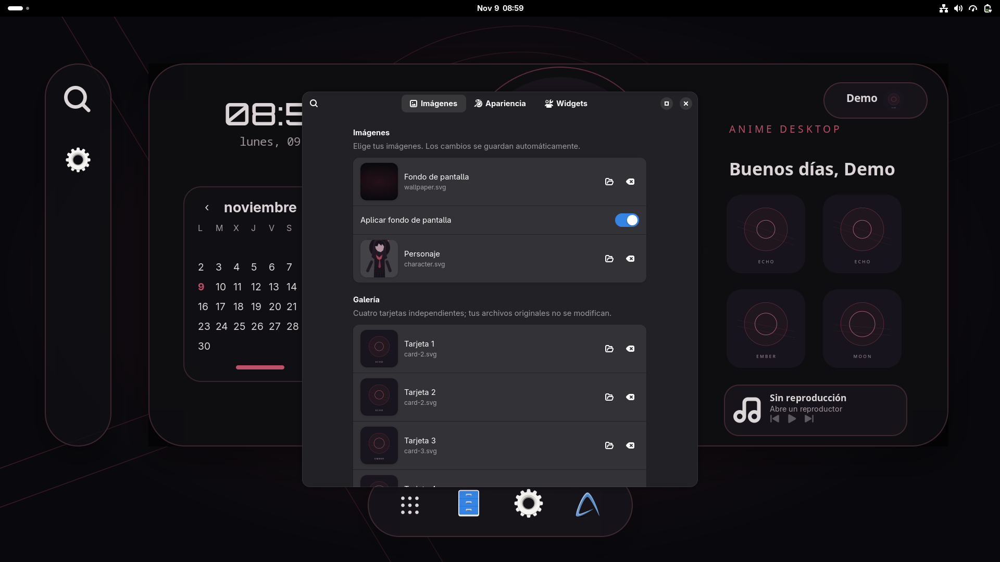

# AnimeDesktop

A modular glass desktop for **GNOME 51 on Wayland**: a floating panel, character artwork, clock, calendar, gallery, app launchers, dock and MPRIS music controls. Written in GJS/St, with text and images rendered at their final size instead of scaling a rasterized interface.

**[Leer en español](docs/README.es.md)** · [Configuration](docs/CONFIGURATION.md) · [Contributing](docs/CONTRIBUTING.md)



## Features

- Dark glass surfaces, configurable colors, native background blur and reduced motion.
- Monthly calendar with navigation, current-day highlighting and leap-year support.
- Event-driven MPRIS discovery and play/pause/previous/next controls.
- Launchers backed by installed `.desktop` applications, running indicators and focus state.
- One composition on the selected monitor, with fallback to the primary monitor.
- Local JSON configuration, file-change reloads, scoped backups and rollback.
- An original SVG demo bundled with the source; Chisa artwork is an optional download.

## Requirements

- GNOME Shell **51**, GJS, Wayland, Python **3.10+**, GTK **4.10+**, libadwaita **1.4+**, Soup **3**, Fontconfig and normal GNOME desktop utilities.
- Node **22+** is needed for development tests, not to run the extension.
- Currently tested on CachyOS GNOME 51.1. Other Shell versions are not declared compatible.

This is a GNOME extension, not a replacement compositor. It uses the private `_backgroundGroup` API for the desktop layer, so Shell updates require compatibility testing.

## Install

Clone this repository into a directory you intend to keep. The installed extension stores a local pointer to this checkout, where its configuration and assets remain.

```bash
git clone https://github.com/JSTranquility/animedesktop.git
cd animedesktop
./scripts/doctor.sh
./scripts/install.sh
./scripts/configure-autostart.sh
```

Save your work, log out of GNOME and log back in. New extension discovery and updated JavaScript modules require a fresh Shell session. Installation does not force a logout or restart.

```bash
./scripts/start.sh
./scripts/stop.sh
./scripts/diagnose.sh
./scripts/rollback.sh --dry-run
./scripts/rollback.sh
```

`install.sh` preserves an existing configuration, backs up an existing installation and installs Orbitron with ownership-aware restoration. It does not install system packages. The UUID is `anime-glass@jsttranquility`, retained for continuity with the original desktop project; installing this checkout replaces that same extension, rather than adding a duplicate.

## Chisa Midnight, optional

Images of Chisa are **not bundled or covered by the MIT license**. Review [the asset sources and credits](assets/chisa-sources.json) and [third-party notices](docs/THIRD_PARTY_NOTICES.md).

```bash
python3 scripts/fetch-assets.py --profile chisa --dry-run
python3 scripts/fetch-assets.py --profile chisa --activate
```

The second command downloads HTTPS images with signature, size and checksum validation, composes a dimmed wallpaper locally and backs up/selects the local configuration. It never executes downloaded content. If an upstream file changes, the downloader stops for review instead of silently accepting it. Missing artwork leaves a safe placeholder state.

## Customize visually

Open the profile badge on the desktop, or run:

```bash
./scripts/preferences.sh
# For the installed extension:
gnome-extensions prefs anime-glass@jsttranquility
```

Double-click an empty area of the titlebar to maximize/restore the window, or use its maximize button.

The native GTK 4/libadwaita window has **Images**, **Appearance** and **Widgets** pages (currently labeled in Spanish). Choose a wallpaper, transparent character and four gallery images with the file picker; change colors, opacity, blur, scale and motion; edit the greeting/clock; and choose installed apps for the dock/sidebar. Changes save automatically and update the desktop installed from this checkout. Original image files are referenced, not edited or deleted. One pre-edit backup is retained per preferences session.



The standalone command can configure a checkout before installation. It does not modify a different checkout or the desktop originally installed from one.

## Configure

Edit `config/settings.json`, created from `config/settings.example.json` during installation. Local settings, downloaded art, logs and backups are excluded from Git. Fonts and original SVG demo assets are included with their licenses.

GNOME desktop integrations are **opt-in**. By default AnimeDesktop does not disable Gridgets/Dash to Dock or quit Hidamari. Enable the specific actions you want under `integration`; see [configuration](docs/CONFIGURATION.md).

## Test and package

```bash
npm test
python3 tests/nested.py
python3 tests/nested.py --dual
python3 tests/nested.py --preferences
gjs -m tests/preferences-store.js
python3 scripts/package-source.py
```

`npm test` runs portable syntax/unit checks and audits the Git index for private state and downloaded artwork. Nested tests require GNOME 51 and start an isolated D-Bus/compositor with temporary preferences. They do not replace the real session. The source archive contains only the reviewed Git index; it is not a standalone GNOME Extensions Store package.

See the [local validation record](docs/VALIDATION.md). GitHub Actions is configured for portable tests. Headless rendering, GPU performance and physical monitor hotplug require separate GNOME testing; no CI badge claims those checks run on GitHub.

## License

Code and original SVG demo assets: [MIT](LICENSE). Orbitron: SIL OFL 1.1, included in `assets/fonts/Orbitron-OFL.txt`. Downloaded third-party artwork retains its owners' terms and is excluded from the repository and source archive.
